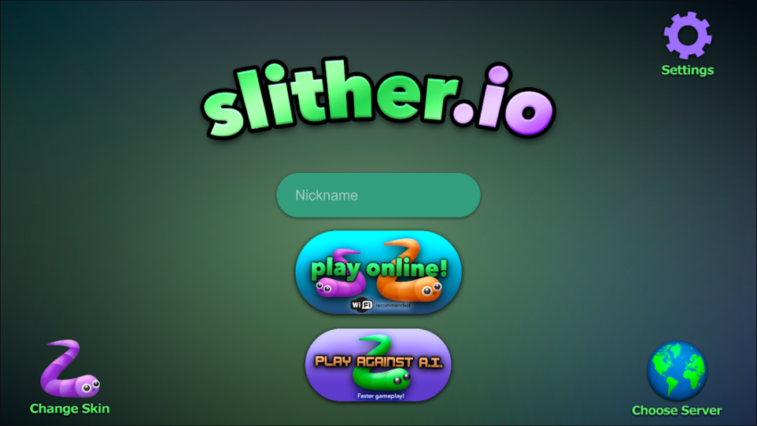
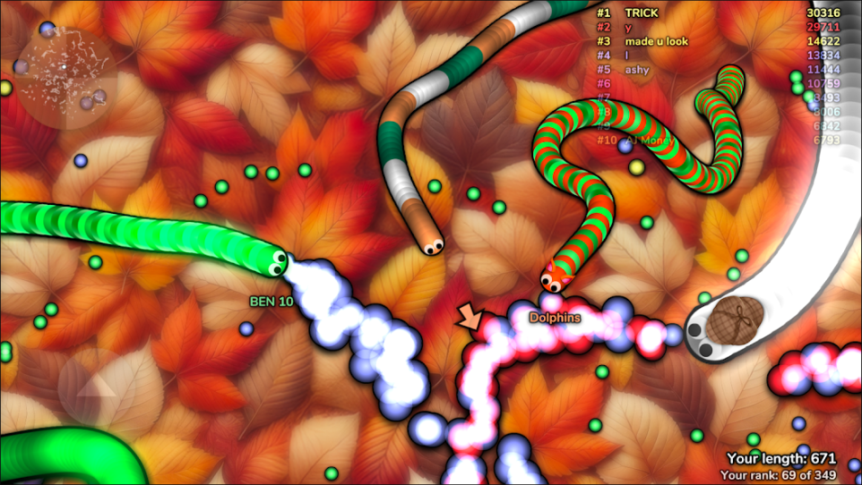
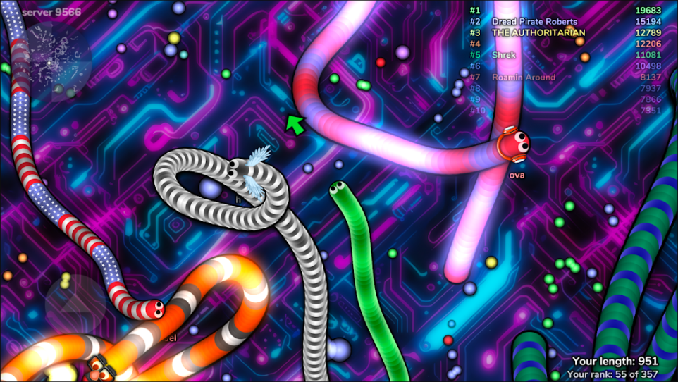
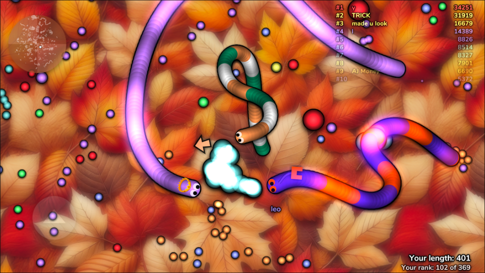

# sshio: complete project plan

**Status:** target architecture and product specification. A first feasibility implementation now exists; see [implemented behavior and validation](IMPLEMENTATION.md). Numeric settings remain experimental.
**Research date:** 2026-11-12. Source identifiers link to [the research register](RESEARCH.md).
**Purpose:** build a game developers choose to play, and use permissioned interaction data plus reproducible simulation to study multi-agent behavior.

## 1. Recommendation

Build **one Rust simulation**, consumed by both a **Rust authoritative multiplayer server** and a **Python native extension** for training. Serve the initial terminal experience through **Russh + Ratatui**. Use **PyTorch** for behavior cloning and recurrent multi-agent PPO, with **PettingZoo** compatibility. Add a **TypeScript + PixiJS** browser client through **Axum WebSockets** after the SSH game is fun.

Keep game rules, transport, rendering, policy decisions, and training separate. Reuse the exact simulation for play, synthetic data, replays, and initial training; a Python reimplementation would introduce avoidable simulation drift.

**Human gameplay data is optional.** The first learned bots can be trained entirely from simulated experience and self-play, before any public player connects. The default delivery path must work with zero human trajectories. Permissioned human data later supports imitation, analysis of human tactics, and evaluation of whether bots are enjoyable opponents; it is not a prerequisite for reinforcement learning.

Use a dark **world-anchored dot field**, not a full grid. Dots provide movement cues while leaving more visual room for striped snakes and varied food. The circular arena boundary remains a separate, unmistakable ring.

Fairness has four foundations: common rules and observations; a conserved mass economy; diminishing benefits and increasing costs of size; and an announced, finite championship lifecycle. Avoid covertly weakening bots, rewarding players with hidden mass, or deleting a leader without explanation.

Assume one region, one deployment, and 24 snakes per arena for the first alpha. All counts, timings, reward weights, and performance budgets below are **initial hypotheses**. Start with one engineer focused on Rust/game systems and one focused on ML/data, with design/testing support; staffing and scope determine actual delivery time.

## 2. Success criteria and research questions

The product loop is: connect → instantly see activity → enter a name and palette → play within seconds → understand the death → retry or spectate → optionally contribute data. No local install, account registration, or key upload is necessary to play.

The research loop is: version rules → collect consented trajectories → validate/replay → train → evaluate on held-out opponents and conditions → deploy a frozen policy → measure game quality and collect new behavior.

Primary questions:

- Does a learned policy outperform a diverse heuristic pool under the same sensing, timing, and movement limits?
- Does human imitation improve sample efficiency, robustness, or encounter quality beyond bot-only training?
- Do fairness mechanics improve newcomer survival and distribution of opportunities without removing mastery?
- How robust is a policy to opponent changes, occupancy, latency, terminal controls, and later browser controls?
- Which platform contracts genuinely transfer to another game, and which must remain game-specific?

Measure product and research independently. Model reward is not a proxy for fun. Track retry rate, voluntary return, first-life experience, perceived fairness, useful consented trajectories, and diversity of tactics. Do not optimize for session length alone or make contribution a condition of fair play.

Non-goals for the first release: custom CUDA physics, a general-purpose game engine, cross-region worlds, tournament-grade anti-collusion, a giant transformer, live online model updates, public arbitrary-code bots, mobile controls, or a simultaneous launch of seven games.

## 3. Language and framework selection

| Option | Benefits | Costs | Decision |
|---|---|---|---|
| Rust core/server + Python ML | One fast native simulation; ownership/isolation; native Python bindings; possible later WASM sharing | Rust learning curve; SSH input and graphics work; native packaging | **Selected** |
| Go + Wish/Bubble Tea + Python | Excellent SSH application ergonomics [S2]; simple operations | Python simulation sharing needs a native bridge/RPC or another implementation; less direct WASM/ML path | Best alternative if terminal delivery speed and existing Go expertise dominate |
| Python throughout | Fast experimentation; natural ML integration | High-throughput collision loops, large batches, and per-client rendering likely need native acceleration eventually | Use for research orchestration, not the canonical physics |
| TypeScript throughout | Fast browser development | SSH-native product and large simulation batches require more integration; Python ML bridge still exists | Use for the browser frontend |
| C++ or JAX-first simulation | Strong native/GPU options | More integration complexity or a GPU-shaped design before profiling; harder initial terminal product | Revisit only for a demonstrated bottleneck |

Selected components:

- Rust stable toolchain, Cargo workspace, Tokio for I/O, Russh for SSH, Ratatui for layout/cell diffing, Crossterm output backend over an SSH writer, termwiz input parsing [S1, S3].
- A custom lightweight 2D snake rasterizer writing into Ratatui cells; no full ECS or general physics engine initially.
- Axum for health/API/WebSockets [S5]. Protobuf messages via `prost` and generated TypeScript bindings for external game messages and persisted events; explicit schema versions.
- PyO3 + maturin + NumPy buffers for `sshio_sim` wheels [S6]; Python packaging with `uv` and a tested lockfile.
- PyTorch, an owned PPO trainer derived from a pinned, attributed CleanRL reference [S9], PettingZoo adapters [S7, S8], TensorBoard and local run manifests initially.
- ONNX export and ONNX Runtime CPU inference through a pinned Rust wrapper for production policies [S12]. Validate that wrapper/runtime packaging early; a batched Python inference sidecar is a fallback, not the default.
- PostgreSQL for small durable metadata; object storage for recordings, datasets, and model artifacts; Parquet/Arrow for datasets; DuckDB/Polars for analysis. Local filesystem substitutes for object storage in development.
- TypeScript, Vite, and PixiJS for the browser game [S18]. Simple DOM menus first; a React dependency is optional if the surrounding product needs it.

Pin actual versions after the compatibility spike. Commit Rust, Python, and frontend locks; record runtime, compiler, model, and schema versions in every experiment. Moving `latest` tags are documentation references, not deployment specifications.

## 4. Product and interaction design

### Connection and lobby

Proposed public command: `ssh play@<game-host>`; add `-t` when the local invocation does not allocate a PTY. This is a purpose-built SSH application, not a shell account. A stable server host key avoids repeated identity warnings. Administration uses a separate endpoint.

On connection, immediately show a gently moving spectator view with a centered opaque modal. The background remains visible but muted. Fields:

1. Display name, generated if blank; maximum 16 display columns.
2. One of eight curated color pairs, each previewed on an animated striped snake.
3. **Play** and **Spectate** actions.
4. A short optional contribution setting: “Help train game AI with your gameplay,” with details available without leaving the lobby. Default off for the research dataset; gameplay access and rules stay identical.

Tab/Shift-Tab navigate, Enter confirms, Esc closes secondary help. A player is not spawned until Play succeeds. Resizing preserves form contents. Small terminals show a compact lobby and the minimum supported dimensions rather than broken UI.

### Controls that actually work over SSH

Legacy terminals do not reliably emit key-up events [S4]. Therefore default to **persistent direction commands**: arrows or WASD set a desired compass direction; optional diagonal keys select diagonals. The snake smoothly turns toward that direction under the same turning limit as every controller. Space toggles boost; the HUD states BOOST ON/OFF. A separate stop-boost key is idempotent. Do not require holding a key in the portable mode.

The adapter converts direction intent to a canonical bounded turn-rate action at each 100 ms control interval. A future mouse/analog adapter uses the same conversion. Set turn rate to zero once the target direction is reached, with an angular dead band to avoid oscillation.

Enhanced mode may negotiate key press/release events and mouse support after a capability handshake. It must fall back cleanly through tmux/screen and must not make an unsupported terminal unplayable. Keep a deliberate absolute-direction keyboard mode available even on advanced terminals. Ignore paste as gameplay input; bound input parsing and distinguish terminal capability responses from key events.

### Match flow

- Join a safe spawn location facing inward with a short ghost preview. While ghosted, the snake cannot collect food, kill, block, or earn score. Recheck clearance before activation; retry instead of spawning inside a body.
- Show mass, boost cost, crown status, score, region/connection status, and a small directional boundary indicator. Keep controls discoverable.
- On death: a brief readable effect, reason, run stats, and immediate Retry/Spectate choices. Show the conflicting head/body location in an optional short replay.
- Spectators can follow a snake, cycle targets, or use a wide view. A full-arena spectator feed should be delayed, initially 15 seconds, to reduce live scouting. Strip hidden competitive state from ordinary player sessions.
- On disconnect, turn boost off and continue the last legal steering state for a short reconnect window, initially three seconds. Reconnection requires an unguessable session token. No invulnerability or reward-earning bot takeover. After the window, retire the snake with a tagged disconnect reason and no kill credit.
- If a terminal becomes too small, offer spectating or continue with a visible warning; do not pause the shared world or grant immunity.

Use persistent identities only when a player opts into an account/key binding. Display names are not authentication. Gameplay pseudonyms, research consent, and operational IP/key information are separate records.

## 5. Game rules and simulation

### Proposed alpha configuration

| Parameter | Starting value | Why it exists |
|---|---|---|
| Arena | Circle, radius 600 world units | Bounded environment and a legible edge |
| Capacity | 24 snakes, initially 12–16 populated slots | Reachable encounters without excessive crowding |
| Simulation | 30 fixed ticks/s | Stable collision and economic updates |
| Control/policy | 10 decisions/s, held over 3 simulation ticks | Common bounded action cadence |
| Terminal output | Adaptive 10–20 frames/s | Responsive rendering within SSH bandwidth |
| Browser output | Up to display refresh, initially 60 frames/s | Interpolation independent of physics |
| Starting mass | 100 integer units | Simple resource accounting |
| Mass pool | 20,000 units per arena | Prevent unbounded inflation |
| Entity bounds | 8,192 active food pellets; 256 body samples per snake | Bounded memory, collision work, and training shapes |
| Base speed / boost | 24 / 42 world units/s before size adjustment | Tune with SSH playtests |
| Visibility | Radius 120 world units | Common local information budget |
| Size thresholds | Soft cost 1,200; crown 1,800; hard cap 3,000 | Diminishing returns and bounded geometry |
| Crown duration | 90 seconds after first trigger | Finite, announced dominant runs |
| Age trigger | Crown starts by 6 min 30 s | Upper life bound of 8 min in this mode |

The age trigger is a transparent arcade rule, not an invisible bot cleanup job. If playtests dislike forced life limits, test a separately versioned round-based mode. Do not silently remove the bound and assume upkeep alone guarantees turnover.

### Movement and collisions

Use continuous positions with fixed simulation time. Represent each snake as a head plus an arc-length-sampled body polyline; body samples are spaced in world distance, not added once per rendered frame. Cache path distance for stripes, tail truncation, and interpolation.

Radius grows slowly with mass, for example `r = clamp(r0 * (m/m0)^0.22, r0, rmax)`, with `r0=2.5` and `rmax=7` as starting values. Length grows more substantially, for example `L = 20 + 0.08*(m-100)`, bounded by the hard mass cap. Tune these independently so a large snake does not become an unreadable wall. A larger radius enlarges the real collision body; cosmetic skins do not alter it.

All snakes keep moving. Larger snakes have mildly lower base speed and a larger minimum turning radius. Bound maximum curvature so a tiny instantaneous turn cannot make the head intersect unrealistic geometry. Boost increases speed, consumes mass, and visibly sheds food; below minimum eligible mass it switches off.

Collision rules:

- Head into another body: the head's owner dies. Touching one's own body is allowed for the initial slither-like ruleset; encode that explicitly.
- Head–head collision: both die in the default mode, avoiding a hidden large-snake priority. Determine all deaths from the same pre-resolution movement state.
- Crossing the circular boundary with the head collision disk: death. Render a warning before contact; do not snap the head away from the edge.
- Use swept head disks against body capsules, with conservative substeps or swept body bounds where segments move. An endpoint-only collision test can miss crossings during boosting.
- Resolve simultaneous food pickup by earliest time of contact; exact ties use a seeded, unbiased tie-break rather than iteration order or a permanently favored ID.
- Compute movement and collision candidates for all snakes, then resolve deaths and food transactions together. Never make “first snake in the array” win by mutating state during detection.

Use a uniform spatial hash for body segments, heads, food, and neighborhood observations. Keep a brute-force implementation as the correctness oracle in tests. Bound maximum snakes, food entities, and body samples; overflow has explicit conservative behavior and metrics, not silent disappearance of hazards.

At the proposed maximum length, sampling about every two world units fits within the 256-sample body bound. If later rules exceed that budget, increase the declared capacity or resample with conservative collision capsules; never shorten an authoritative body to fit a buffer. When food capacity is reached, keep new mass in reserve or merge nearby compatible pellets with value-preserving accounting.

### Reproducibility contract

The core has no clock reads, network calls, filesystem reads, or global randomness. It receives a seed, versioned configuration, ordered inputs, and fixed steps. Separate RNG streams cover spawning, food, and tie-breaking so cosmetic activity cannot change the world.

Start with deterministic ordering and an explicitly specified numeric model. Floating-point replay guarantees initially apply to the same pinned build/target with tested compiler settings; do not promise cross-CPU/WASM bit equality. Record periodic authoritative checkpoints and hashes. If cross-target lockstep later becomes necessary, migrate the relevant math to fixed-point/quantized operations under a new ruleset and differential tests.

The terminal and browser need consistent server authority, not full lockstep. Cosmetic interpolation may differ without changing outcomes.

## 6. Fairness and the food economy

### Conserved mass

For each arena, maintain:

`M_total = M_snakes + M_food + M_reserve`

Reserve includes delayed redistribution credits; these are not counted again when queued. Every transfer is an integer transaction. No negative balances, hidden inflation, or clamping away leftovers. Fractional upkeep accrues in fixed-point remainders until an integer transfer is due.

Initial example: 2,400 in 24 starting snakes, approximately 8,000 in food, and 9,600 in reserve. With fewer snakes, their unallocated spawn mass remains in reserve. Maintain enough reserved mass for vacant slots to spawn: food allocation may not spend `m0 * vacant_slots`. Spawning consumes its reserved amount and reduces vacant slots together. Queue a join if safety, capacity, or resources cannot support it.

| Event | Source | Destination |
|---|---|---|
| Eat food | Food | Snake, up to its mass cap; any uneaten portion remains food |
| Spawn | Reserve | Starting snake mass |
| Boost | Snake | Initially 70% trail pellets, 30% reserve, with exact remainder accounting |
| Size upkeep | Snake | Reserve for later redistribution |
| Death or completed reign | Snake | Initially 40% nearby corpse food, 60% reserve |
| Food expiration | Food | Reserve |
| Redistribution | Reserve | Food in eligible under-supplied areas |

For a death's 60% reserve share, tentatively earmark 40 percentage points for a staged global bloom and retain 20 for ordinary replenishment/spawn reserve. These are allocations within reserve, not extra mass. Food-entity limits use pellet merging or delayed releases; they never manufacture or destroy value.

### Preventing runaway accumulation

1. **Superlinear upkeep above a soft threshold.** A starting formula is `u(m) = k * max(0, m/m_soft - 1)^2` mass/s. Choose `k` from measured intake rates and sweep it; below the threshold ordinary play incurs no idle tax. Display the drain once relevant. Use a smooth ramp, not an unexplained threshold cliff.
2. **Diminishing maneuverability.** Size helps enclosing opponents but reduces agility and increases collision exposure. Boost costs also rise with mass. Small snakes retain credible escape paths.
3. **Hard geometry cap.** At 3,000 mass the snake cannot absorb additional mass. Leave surplus food in the world; do not create food-destroying immortal giants.
4. **Finite crown lifecycle.** Crossing 1,800 mass starts a persistent 90-second reign timer, even if the snake later sheds mass. Age starts the same timer at 6:30 if it has not already begun. A crown badge, HUD timer, and final 15-second warning make this known. When it ends, the snake dies in a celebrated bloom and the player can restart. This applies to humans and every bot.
5. **Separate score from stored mass.** Recognize peak mass, survival milestones, completed crowns, and legitimate eliminations. Use daily/seasonal boards so “who stayed alive longest on an empty server” is not the sole achievement.

Do not reward a bot for deliberately missing actions, knowing it is observed, or targeting a selected player more weakly. Skill bands are visible policy variants with fixed limits, selected at match entry. Label bots in the roster.

### Redistribution rather than feeding the winner

Partition the circle into equal-area sectors: choose radial boundaries proportional to `sqrt(i/n)` and subdivide angles, or use Cartesian cells with clipped-area correction. Uniform radius sampling overweights the center; uniform disk points use `r=R*sqrt(U)`.

Every second, calculate a bounded target food mass per usable area, penalizing recently saturated cells and dense hostile-body occupancy. Transfer reserve to undersupplied reachable cells subject to a global emission budget. Mix this with a substantial uniform component so players cannot perfectly predict a “poor area subsidy.”

Spawn new food with a short visual fade-in away from active head collision disks; fade-in food is not collectible until active. Avoid putting emergency food directly under a favored player. Expire old uneaten pellets gradually, particularly corpse clusters, and return their mass to reserve. A central scheduler caps these operations so a large death cannot cause a tick spike.

Keep corpse food valuable locally but spread the majority through the arena. Mark pellet provenance, including originating life and recent boost owner, to analyze recapture loops. Do not grant score or positive reward for repeatedly shedding and eating one's own trail.

### Spawn, occupancy, latency, and information fairness

- Spawn safety considers head approach speed, nearby body clearance, boundary distance, and a short forward corridor. A ghost cannot consume or influence collisions.
- Fill quiet arenas with varied bots; remove them at natural death/crown completion when humans need slots. Do not vaporize a nearby opponent to make room. Admit to another arena when needed.
- Enforce the same observation radius and public state fields for heuristic and learned policies. Private RNG, offscreen pellets, future events, and other players' inputs never reach the actor.
- Standardize decision intervals and minimum bot reaction delay, initially 100–200 ms to test. Bots act on delayed observation snapshots, not privileged current state. Log applied delay and randomize realistic latency in training.
- Bound humans' input rate too; accept the latest valid command per control window. Do not delay every player to match the slowest connection. Latency equality cannot be perfect: use regional routing and evaluate outcomes by RTT and jitter.
- Keep competitive field of view fixed in world space, regardless of terminal dimensions or browser resolution. Larger screens improve clarity, not sight distance. Cosmetic camera interpolation and zoom cannot reveal more territory.
- A semantic bot observation is easier to read than pixels. Equal visibility is therefore an operational fairness constraint, not proof that humans and bots have identical perception. Evaluate reaction and skill limits empirically and offer labeled difficulty bands.

### Balance evaluation

Run long, accelerated population simulations and real playtests. Measure mass concentration/Gini, largest mass share, leadership tenure, newcomer survival, deaths near spawn, food accessibility, mass flow, encounter rates, boost recapture, and results by bot policy and latency bucket. High inequality can reflect earned skill; no single statistic defines fairness.

Test adversarial strategies: empty-arena farming, camping a corpse, repeated self-feeding, threshold dipping to reset crown timers, cooperating sacrifice accounts, disconnect avoidance, spawn shielding, ring trapping, and intentional food starvation. Use deterministic scenario fixtures plus diverse seeded runs. Keep an ablation for each fairness mechanic so complexity earns its place.

Initial playtest objectives, subject to revision: almost no unavoidable spawn deaths in the first three seconds, most new players able to survive long enough to learn steering, regular leader turnover, and clearly understood death causes. The hard guarantees are conservation, caps, symmetric rules, and finite reigns; exact survival/retention targets require a baseline.

## 7. Visual design and terminal rendering

### Slither.io image references

The following are publisher-provided screenshots from [Slither.io by Lowtech Studios on Google Play](https://play.google.com/store/apps/details?id=air.com.hypah.io.slither&hl=en), captured through the browser on 2026-11-12 [S19]. Local PNG copies make this document usable without depending on an external image host. Browser margins were cropped; the artwork itself is unchanged. Original image URLs, capture provenance, and checksums are recorded in [the image manifest](assets/slitherio/sources.json). These are reference images of Slither.io, not sshio mockups or assets to ship in the game; original artwork and branding remain with their respective owners.

**Reference 1 — entry and customization.** A short nickname field and prominent play action keep the entry flow simple, with skin selection nearby. For sshio, adapt that economy of interaction into the requested name/color/play/spectate modal over the live arena. This image does not itself depict that proposed live-background modal.



**Reference 2 — body scale and food clusters.** Thick and thin bodies coexist, eyes identify heads, and small dispersed pellets contrast with bright clusters. Preserve those distinctions in the terminal through clear head markers, different body widths, and multiple food shapes. Keep the collision silhouette readable when food glows nearby.



**Reference 3 — stripes, highlights, and direction.** The bodies show alternating colors, repeated bands, curved silhouettes, and strong highlights. Use this as a reference for stripe continuity and visual energy. A still image does not establish an animation's timing or prove a particular snake is boosting; sshio's moving boost highlight remains a separately specified effect.



**Reference 4 — food variety and compact HUD.** Pellets vary in visible size and hue, while rank/length and the leaderboard occupy the edges. For sshio, size/shape should communicate food value, with restrained edge HUD placement and a visible boost/crown state.



These current promotional screenshots include autumn-leaf and neon-circuit backgrounds. They illustrate snake/food rendering, not the background selected for sshio. Retain the dark world-anchored dots specified below, with a geometric circular boundary; do not infer the arena boundary from the rectangular screenshot or circular minimap. Simplify fine texture and strong bloom for terminal readability.

### Visual language

Use a nearly black blue background, subdued blue-gray dots, and a brighter boundary. Candidate base colors: background `#080D18`, dots `#18243A`, boundary `#567096`. These are design starting points; terminal palette conversion and actual contrast need testing.

Eight curated snake palettes use alternating light/dark stripes: cyan/teal, amber/orange, violet/lilac, coral/rose, lime/forest, blue/ice, gold/cream, and pink/plum. Ensure each remains distinguishable against food and the arena. Players choose a palette, not arbitrary near-black/invisible colors. Add pattern/shape cues for color-vision accessibility and distinguish the local head with a small marker.

Stripes follow distance along the body, with a stable phase attached to material/body coordinates. Changing body sample count or frame rate must not make stripes flicker or reverse. A rounded head, bright eyes/direction marker, tapered tail, and subtle edge shading improve readability. Use at least three visibly distinguishable widths over the growth range, based on continuous collision radius rather than cosmetic advantages.

During boost, animate a moving highlight through the stripes and a low-intensity edge halo. The trail communicates mass cost. Terminal “glow” is an approximation using adjacent tinted cells; web can add a restrained shader bloom. Reduced-motion mode replaces traveling highlights with a steady bright outline and a HUD icon. Avoid whole-screen flashing and high-contrast stripe strobing.

Food uses several hues and three value classes, initially 1/3/8 mass units. Hue is mostly visual variety; size/shape communicates value. Small dots, medium rounded diamonds, and larger clusters remain recognizable in 256-color mode. Give food a physical pickup radius correlated with value; decorative glow does not enlarge it. Local merging preserves total value and the displayed class/amount must remain honest.

### World and camera

Dots are fixed in world coordinates and move only as the camera moves. Do not randomly regenerate them each frame. Use deterministic coordinate hashing for small brightness variation, independent of gameplay RNG. A few widely spaced major dots can provide scale without turning the screen into a grid. Low-bandwidth mode reduces dot density.

The arena is geometrically circular. A following camera shows the nearby boundary arc when approached; a small minimap shows the overall circle and public information only. A terminal character cell is usually taller than it is wide, so a naive cell-coordinate circle will look elliptical. Account for cell aspect ratio, with calibration/fallback when pixel dimensions are unavailable.

Keep the competitive view a fixed world-space circle, fitted within the available board. Letterbox the extra area or use it for HUD; do not expand vision on a wide terminal. Camera smoothing may use known states for aesthetics but must not shift collision logic. Do not oversmooth a head near the edge.

### Renderer tiers

| Tier | Rendering approach | Purpose |
|---|---|---|
| Preferred | Truecolor + Unicode upper/lower half-blocks (`▀`, `▄`) | Two independently colored vertical samples per cell; good solid striped bodies |
| Compatible | 256-color palette + half-blocks | Common terminals and multiplexer setups |
| Basic | ASCII + 16 colors or monochrome | Readable fallbacks, diagnostic clients, limited terminals |

Braille provides more occupancy samples but generally one foreground color per character, which is a poor default for multicolored thick striped snakes. Keep it as an optional rendering experiment, not the main approach. Do not require Kitty graphics, Sixel, Nerd Fonts, emoji, or image support.

Rasterize a modest subcell canvas, then map top/bottom samples to each terminal cell. Layer dots, food, distant bodies, nearby bodies, heads, effects, HUD, and modal panels. Use collision-consistent body outlines and minimal visual smoothing; decorative interpolation must not hide a lethal occupied region. The lobby modal uses an opaque interior so text is readable over motion.

### Output and input engineering

- One Ratatui screen state and input parser per SSH channel. Do not use the process-wide local stdin or raw-mode controls as though every player shared a local terminal.
- Handle PTY dimensions and window-change messages with bounded dimensions. Clear and fully redraw after resize or capability changes.
- Generate cell diffs; group adjacent style runs to reduce escape-sequence overhead. Limit colors and animated cells when bandwidth is constrained.
- Use bounded queues. Coalesce **world/render snapshots before encoding**; do not arbitrarily drop already encoded incremental ANSI frames, because later diffs depend on them. If a stream must resynchronize, send a complete redraw at a well-defined frame boundary.
- Never hold an arena lock while rendering or awaiting an SSH write. A slow spectator cannot stall simulation or consume an unbounded buffer.
- Cap bytes/frame and bytes/session/s, lower output FPS before sacrificing simulation rate, and disconnect a persistently unwritable session cleanly.
- Sanitize all player strings: remove ANSI/C0/C1 control sequences, misleading bidi controls, and unsafe width behavior; bound graphemes and display columns. Render markup as literal text.
- Restore cursor visibility, alternate-screen mode, mouse mode, and negotiated keyboard flags on clean exit. Provide recovery instructions for abrupt terminal interruption.

Minimum playable target: 80×24; recommended 120×40 or more. The spike must verify that minimum-size snake bodies, nearby collision gaps, food classes, and the boundary are distinguishable at both sizes. If 80×24 fails, raise the minimum or adjust visual/world scale rather than pretending it is usable.

## 8. Software structure and contracts

### Repository layout

```text
sshio/
  crates/
    game-api/             shared IDs, lifecycle, typed capabilities
    arena-runtime/        scheduling, sessions, snapshot publication
    sshio-core/           pure rules, geometry, economy, RNG, checkpoints
    sshio-observation/    visibility, compact observations, action adaptation
    sshio-bots/           heuristic policies and policy interface
    sshio-render/         terminal rasterizer, palettes, presentation
    sshio-server/         Tokio, Russh, Ratatui sessions, Axum
    sshio-replay/         recording validation and deterministic replay
    sshio-python/         PyO3 batch bridge; no game-rule duplication
    policy-runtime/      ONNX inference and fallback controller
  python/sshio_ml/
    envs/                 PettingZoo and Gymnasium adapters
    data/                 validation, conversion, sequence loading
    policies/             actor/critic definitions
    train/                imitation, PPO, curriculum, checkpoints
    eval/                 frozen suites, cross-play, reporting
  web/                    TypeScript + PixiJS, later milestone
  protocol/               Protobuf definitions and schema fixtures
  configs/                rulesets, fairness sweeps, training presets
  notebooks/              smoke, data, train, evaluate, export
  tests/                  golden scenarios, property tests, replay fixtures
  benchmarks/             headless, collision, render, ML throughput
  deploy/                 service/container configs and dashboards
  docs/                   ADRs, product rules, datasets, model cards
```

This is a target decomposition, not a requirement to create fourteen mostly empty crates on day one. Start with core, server/rendering, and Python bindings; split along tested boundaries as code grows.

### Core interfaces

Conceptual Rust contracts:

```rust
// Pure game code; these signatures are design sketches, not a stable public API.
fn reset(seed: Seed, rules: &Rules) -> World;
fn step(world: &mut World, actions: &ActionBatch) -> StepEvents;
fn observe(world: &World, agent: AgentId, profile: ObservationProfile) -> Observation;
fn snapshot(world: &World) -> Checkpoint;
fn restore(checkpoint: &Checkpoint, rules: &Rules) -> Result<World>;

trait Policy {
    fn act(&mut self, obs: &Observation, context: &DecisionContext) -> Action;
    fn reset_life(&mut self, id: LifeId);
}
```

`Action` contains normalized turn rate in `[-1,1]` and a boost boolean. The core clamps/validates it; NaNs, infinities, missing actors, invalid IDs, or excessive rates never alter state illegally. The normalized turn rate maps to the mass-dependent angular-speed limit. Controllers receive no mutable `World` access.

Keep three representations separate:

1. **Authoritative state:** exact world geometry, balances, RNG streams, policy-independent lifecycle.
2. **Player view:** visible geometry, permitted public metadata, effects, and UI state for rendering.
3. **Learning observation:** bounded numeric features derived from permitted information, with masks and history. It is not a serialized entire world.

Rewards are derived from versioned events in the training layer, not hard-wired into movement. The server can compute product scores without importing PyTorch. Export schemas make observation/action semantics explicit so old models cannot accidentally control a new ruleset.

### Internal execution

One owner advances each arena world. Networking tasks send bounded commands to that owner; the owner publishes immutable snapshots. Multiple arenas can run on a worker pool, with parallelism across arenas before parallelizing one arena's deterministic resolution.

Separate rates: physics 30 Hz, control 10 Hz, bots 10 Hz or slower, food scheduling 1 Hz, render 10–20 Hz. Control decisions see a named snapshot; actions enter an explicit future tick according to the allowed delay. Join/leave/config events also enter at deterministic boundaries.

Training bypasses Tokio, SSH, renderers, and wall time. Native `BatchWorld` owns many worlds, steps them in a bounded Rayon pool, and writes contiguous observations/results. The Python call releases the GIL while Rust computes. Preallocate storage and avoid a Python dictionary/object per entity in the hot path.

## 9. Multiplayer protocol, deployment, and operations

SSH clients send terminal input and receive ANSI frames; they do not need the external binary protocol. A session adapter maps their intents to the same internal commands used by future web clients. Avoid routing local simulation through RPC merely to share code.

The web protocol includes `Hello`, protocol/rules negotiation, `Join`, `Input`, `InputAck`, `Snapshot`, `Events`, `Ping`, `Resume`, and `Error`. An input carries session/life ID, monotonically increasing sequence, and action; the server determines application tick. Client timestamps are diagnostic, not authority. Reject replayed input and clamp future tick hints.

Start with visible-state snapshots at 10–15 Hz over WebSocket; add delta encoding only after measuring. Snapshots carry authoritative tick and latest accepted input sequence. The browser interpolates remote geometry and may predict local steering, reconciling against the server. It cannot predict authoritative kills or food ownership. Shared Rust/WASM movement is a later optional optimization; it is not needed to launch a correct browser client.

Terminal input lacks reliable end-user event timestamps and presentation acknowledgments. Log server receipt/application accurately and label terminal display timing as an estimate. SSH RTT alone does not reveal exactly which frame the user saw.

### Practical latency policy

Use TCP_NODELAY where supported, short bounded write buffers, and regional placement. Both SSH and WebSocket inherit TCP head-of-line blocking; do not promise a UDP-like experience. Keep interpolation short and measure the tradeoff between smoothness and delay. For snakes, historical rollback can invalidate shared body/food collisions, so start without combat rollback; use conservative movement and transparent connection feedback.

Choose input action cadence based on playtests. If 10 Hz feels sluggish, raise it for both humans and bots under a versioned config and retrain/evaluate; do not quietly give one side 30 Hz.

### Deployment progression

1. Local executable and Python wheel; development-only in-memory metadata.
2. One regional VM running the app, PostgreSQL, and asynchronous object uploads. Static browser assets later use a CDN. A CPU server runs the first heuristic and compact learned bots.
3. Separate arena workers only when profiling or fault isolation requires it. Route players to a sticky arena owner. Scale by arena, not by sharing one world across processes.
4. Add regional routing, a registry/cache, and orchestration when occupancy and measured cost justify them. Kubernetes, Redis, Kafka, and Ray are not alpha prerequisites.

For ML production, batch inference per policy/model across bot decisions. Run it outside the physics deadline. If it misses its budget or produces invalid output, use a deterministic safe heuristic and record the fallback. Pin a model for a life; hot-swap at the next spawn, resetting recurrent memory. Maintain a one-command rollback to the previous model/ruleset bundle.

### Robustness and operational security

The SSH service accepts only the application session/PTY flow; deny shell execution, SFTP/SCP, forwarding, agent forwarding, and unrelated channels. Run as a dedicated unprivileged user, with persistent host keys, bounded sessions, handshake/input limits, and minimal filesystem access. These are core server requirements, not a request for users to provide credentials.

Authentication may be anonymous for casual play; optional SSH public-key identity is verified by normal SSH signing without collecting private keys. Do not record raw terminal streams, pasted secrets, or capability responses into datasets. Rate-limit connection floods and repeated joins; add account requirements only for competitive features that need them.

Monitor tick duration, missed ticks, arena occupancy, socket backlog, disconnects, bytes/session, food/mass invariants, inference latency/fallbacks, replay failures, and recording loss. Logs are structured and exclude names/keys by default. Health and readiness distinguish a live process from an overloaded arena scheduler.

On overload, stop admitting new players and lower visual output before degrading physics. Do not skip arbitrary simulation ticks. A crashed casual arena may restart with a clear interruption message; transparent live migration is deferred. Save enough replay/checkpoint context to debug the failure.

## 10. Heuristic bots and the path to learned policies

### Useful initial bots

Use a utility controller with short-horizon collision prediction, not a single “nearest food” rule. Evaluate a bounded set of candidate turns and boost decisions using time-to-collision, boundary risk, accessible food value per travel time, future escape space, boost cost, and nearby head interception.

Implement a common safety layer and several visible play styles:

- Forager: favors safe, spread-out food.
- Scavenger: approaches deaths but avoids crowding and traps.
- Opportunist: tries short, defensible cuts across opponents.
- Explorer: changes regions when local opportunities decline.
- Cautious large snake: preserves maneuvering room rather than endlessly circling a single pellet farm.

A state machine handles spawn orientation, ordinary movement, escape, boost, and crown behavior. Seed stochastic choices; vary weights and reaction limits within declared profiles. Bots use the same observation builder as learned actors. Heuristics may plan hypothetical local paths, but cannot query future true state.

Retain all baseline versions as immutable opponents. Synthetic datasets should contain failures, recoveries, contested food, large/small matchups, and unusual boundaries, not only successful harvesting.

### Observation and model design

Start with structured, egocentric data instead of screenshots. A proposed bounded observation contains:

- Self: normalized mass, radius, length, speed, boost eligibility, turn limit, crown/age timers, and previous action.
- Boundary: distance and direction to the nearest wall, visibility coverage, and observation age.
- Local geometry: approximately 64 angular rays with nearest hostile-body distance; nearby head relative position/velocity; food value aggregated into angular/radial bins.
- Entity tokens: nearest/relevant visible opponent heads and body segments, with owner grouping, relative position, tangent, radius, boost/crown state, and validity masks. Include a conservative occupancy representation so truncating the token list cannot hide a collision threat.
- A short history or recurrent state to infer velocities and partially observed maneuvers.

Start with a small MLP over rays/scalars plus pooled entity features, then a 128–256-unit GRU if memory improves held-out results. A candidate model budget is hundreds of thousands to roughly two million parameters; this is an experiment range, not a required size. A very large model is unlikely to solve sparse encounters or flawed rewards.

The action distribution has a bounded continuous turn component and Bernoulli boost. Implement correct log probabilities for the selected bounded distribution, action scaling, and masks. Boost legality is explicit. Humans' canonical turn actions can be used directly for imitation without treating terminal keystrokes as the motor action.

A first critic can use the same local features. Later, a centralized critic may consume the full training world under centralized training/decentralized execution, with strict actor/critic separation. Never export privileged critic features to the live actor. Test that changing hidden state outside the observation region cannot directly change the actor input.

## 11. Data collection and datasets

### Two recording purposes

**Operational replay** exists to diagnose crashes and disputed collisions, has a short explicit retention policy, restricted access, and is excluded from training by default. **Research capture** requires participation consent and produces a versioned dataset with known rights and lineage.

Full multiplayer replay includes other participants' actions. Therefore do not assume one player's opt-in authorizes a complete arena's training log. Initial policy: research-enabled arenas contain consenting humans and bots only; standard arenas do not export human trajectories for training. Offer the same rules and comparable bot/population profiles in both. If consent is withdrawn, end capture eligibility at a clear boundary and honor removal of identifiable recorded data; do not reconstruct an opted-out player's policy from an opponent's replay.

This segmentation may reduce data volume and change opponent mix; record that selection bias. A later policy for anonymized incidental observations requires an explicit review and clear disclosure. Do not silently treat all gameplay as training material.

### Record at the right level

An arena recording header contains arena/episode IDs, timestamps, simulation build hash, ruleset/config hash, RNG seeds, schema versions, observation/action versions, policy versions, capture eligibility, and platform capabilities. Events include joins, validated/applied actions, spawns, pickups, boost/upkeep transfers, collisions, deaths, crown transitions, disconnects, and queue/recording loss.

Store periodic full checkpoints, initially every 2–5 seconds, plus ordered input/event streams and state hashes. Replaying a world requires **all** actors' actions and lifecycle events, including bot actions; logging only the learner's actions is insufficient.

Per decision/transition, preserve:

```text
arena_id, world_episode_id, agent_slot, life_id, pseudonymous_participant_id
sim_tick, observation_tick, input_receive_tick, applied_tick, input_sequence
observation_profile, view/frame_reference, view_delivery_status
requested_action, applied_action, legality_mask, fallback_reason
reward_components, reward_version, terminated, truncated, end_reason
human/bot, controller_type, policy_version, model_logprob_if_known
capability_profile, RTT/jitter_estimate, consent_scope, recording_quality
```

Do not invent a behavior-policy log probability for human or heuristic actions. Store it as unavailable. Keep raw pre-clamp intent only if useful and safe; the canonical applied action is the action that actually caused the transition.

For human imitation, distinguish the world state at action application from the information available when the player chose. Web can report last displayed snapshot/acknowledgment; SSH can report server-side frame creation/write completion but cannot prove presentation time. Retain a small history window and use latency-aware alignment with uncertainty flags. Train and evaluate on realistic observation delays rather than pairing a delayed human reaction with a perfect current state.

### Data formats and lifecycle

Write compressed append-only event chunks with checksums and a bounded local spool. Upload asynchronously; disk/object-store stalls never block an arena tick. If recording drops data, mark the affected interval unreplayable, emit a metric, and exclude it from sequence training rather than silently filling it in.

Offline processing validates hashes and invariants, rebuilds observations with the matching core/rules version, derives reward components, and emits Parquet shards. Keep raw events separate from derived training tables. For high-throughput training, compact the necessary sequence tensors into memory-mapped arrays or batched Arrow buffers after profiling.

Split by participant and time, with entire arena sessions confined to one split. Random row splitting leaks adjacent states and shared encounters into validation. Keep a final locked holdout of opponents/seeds/rules and human sessions. Group anonymous sessions conservatively and disclose when cross-session identity cannot be resolved.

Store dataset manifests with source eligibility, content hashes, feature definitions, known biases, deletion tombstones, and train/validation/test membership. Model manifests identify the exact dataset snapshot. Proposed starting retention: operational replays 24–72 hours, consented raw research captures 30 days, curated pseudonymous datasets 180 days, subject to a published policy and actual research needs. Removal from a dataset does not automatically untrain an existing model; disclose that limit and track affected model lineage.

Avoid user names, SSH public keys, IP addresses, terminal titles, chat, or arbitrary pasted text in training shards. Keep any optional reidentification/deletion mapping in a separate access-controlled store. Aggregate product metrics separately from model training records.

### Quantity is not quality

Track unique contributors, behavior diversity, opponents, terminal/client types, latency, near-death states, and distribution across life lengths/masses. Cap each participant's influence and use balanced sequence sampling. A few skilled marathon players should not define the entire policy. Bots and humans always have explicit provenance; never present synthetic trajectories as human data.

At 10 decisions/s, 100 player-hours yield 3.6 million decision records. If a derived record averages 1 KiB, that is about 3.7 GB decimal uncompressed; at 4 KiB it is about 14.7 GB. These are arithmetic planning scenarios, not measured compression ratios, and exclude checkpoints/full-world logs. Record actual bytes per player-hour before choosing retention and storage budgets.

## 12. Training strategy, rewards, and evaluation

### Training without humans: the default first release

**Yes: the agents can learn by playing against themselves.** The simulator provides observations, consequences, and rewards, so no human action labels or prerecorded human games are required. Self-play is a way to generate opponents and experience; PPO is the algorithm that updates the policy from that experience. An actor network can start with random weights and improve through trial and error.

There are two distinct human-free routes:

- **From scratch:** randomly initialized actors explore simple simulated arenas, learn basic steering/feeding, and progress into multi-agent self-play. No demonstrations are used. Heuristics can remain evaluation opponents; a stricter experiment also excludes them from training.
- **Synthetic warm start, recommended for delivery:** optionally imitate the existing heuristic bots to obtain basic movement, then improve with RL and a league of learned opponents. This still uses zero human data. Imitation is a speed/engineering convenience, not an architectural dependency or a ceiling on learned skill.

The precedent is well established: AlphaZero learned chess, shogi, and Go through self-play starting from random play [S20]. That supports the feasibility of learning without human demonstrations, but its search algorithm, perfect-information games, hardware, and training times are not a performance prediction for this continuous, partially observed, many-player arena. sshio should begin with the compact PPO design below rather than copy an AlphaZero/MCTS system wholesale.

### Concrete self-play loop

1. Initialize the learner and many seeded native arena instances. Give each controlled snake independent recurrent memory, stochastic action samples, and a separate life ID even when actors share network weights.
2. At rollout start, freeze the current actor version. Populate opponents with copies of that actor and frozen historical actors; optionally include diverse heuristics during bootstrapping. Randomize spawn/slot assignment so identities do not confer an advantage.
3. Run the canonical simulation without wall-clock pacing or rendering. Each actor sees only its allowed local observation and receives its own reward. Record the action, observation, behavior log probability, value estimate, terminal/reset masks, and policy version.
4. Update the learner with PPO using fresh transitions generated by its frozen rollout version. Historical-opponent and heuristic actions affect the world, but their trajectories do not become on-policy learner samples. They can be analyzed or used in a separately declared imitation objective.
5. Evaluate the candidate against a fixed benchmark pool and held-out seeds. Add useful checkpoints to the opponent archive, retain strategically different old opponents, and repeat. No human server needs to be running during this process.

Pure latest-versus-latest self-play is a useful baseline, but it creates moving targets. It can forget old tactics, learn brittle conventions, cycle between strategies, or exploit the reward instead of becoming a better opponent. A league containing historical policies, diverse starts, and fixed evaluation opponents reduces those risks. Keep the number of resident models small enough for batched inference; archive more checkpoints on disk.

Sharing a network does not mean all snakes share a team reward. Use individual rewards and independent agent state for this competitive game. Monitor passive coexistence, mutual farming, and repeated sacrifices; do not mistake a high average population reward for stronger competitive play. Self-play offers no automatic convergence or guarantee of fun.

Start with learnable navigation/food tasks, then a few opponents and full-size arenas. Random policies in a sparse 24-snake world may collect very little useful feedback. Preserve the full game's rules for final evaluation, and label any curriculum simplification. Turn off demonstrations, human datasets, and external replay downloads in a dedicated `synthetic_only` preset; the command-line and Colab workflows must run end to end with that preset.

### What human data contributes later

Human data can introduce tactics missing from the self-play population, teach a more human-like control style, and support studies of player/bot interactions. Human playtests remain valuable for assessing enjoyment and perceived fairness even when no human trajectories enter model training. A strong self-play score does not establish either of those product qualities.

Keep three comparable experiments: scratch self-play, heuristic-warm-start self-play, and self-play plus optional human imitation. Match evaluation conditions and report compute/sample budgets. The first learned-bot milestone is a complete **zero-human-data** training/evaluation/export cycle, showing reproducible improvement over declared baselines across multiple seeds; later human-data work must justify its benefit rather than block this milestone.

### Staged learning program

**Stage A — correctness and baselines.** Random, straight-line, boundary-avoidance, and heuristic policies establish sanity checks. Verify that a no-op learner cannot obtain high reward through spawning, disconnecting, or eating its own trail. Implement a scripted small scenario whose expected good action is unambiguous.

**Stage B — optional imitation warm start.** Train behavior cloning on diverse heuristic trajectories, or skip this stage entirely for scratch self-play. Human imitation is a later optional branch when consented data exists. Use continuous-turn likelihood/regression and boost classification, reporting results separately by controller/input style and skill band. Sample failures and recoveries, not only high-score lives. Compare synthetic-only, human-only, and mixed datasets at comparable budgets when those datasets are available.

**Stage C — recurrent independent PPO.** Share actor weights across same-role snakes, use proper per-life hidden-state resets and masks, and train against a fixed mixture of heuristic and frozen learned opponents. This is a multi-agent adaptation of a reference PPO implementation, not an assumption that a single-agent library works unchanged. Bootstrap and compute GAE separately for each life; never let returns flow across death into respawn.

**Stage D — league self-play.** Sample current opponents, historical checkpoints, and behaviorally distinct heuristics. An initial experiment can allocate roughly half to historical learned opponents and split the remainder between current policies and heuristics; tune based on cross-play coverage. Add exploiters only when the basic league is stable. Protect against catastrophic forgetting and cyclic wins by maintaining a payoff matrix rather than promoting on one opponent.

**Stage E — optional research upgrades.** Centralized critics, entity attention, auxiliary collision forecasting, human preference learning, offline RL, or larger policies must each beat the simpler baseline under a fixed evaluation budget. Human logs are valuable for imitation and behavioral analysis; they are not automatically valid on-policy PPO data. Offline RL needs explicit treatment of unknown behavior probabilities and coverage limits.

### Curriculum

Begin with food seeking and boundary avoidance; add a small number of weak opponents; increase density, body length, and opponent variety; then add boosts, crown behavior, and the full economy. Early simplified worlds are tagged as curriculum domains. Finish training and evaluate in the complete live ruleset so the final agent does not depend on disabled mechanics.

Use scenario sampling for spawn exits, narrow passages, contested corpses, late-turn escapes, boost depletion, boundary approaches, crown endings, and large-body congestion. Sample observations near interesting events without violating the temporal sequences required by a recurrent policy.

Randomize seeds, spawn layouts, population mix, observation/control delay, missed decisions, and benign numerical/view variations within the supported domain. Do not randomize game laws so broadly that the agent never learns a stable game. Terminal visual palettes need no randomization for structured-state actors, but visual-policy experiments would.

### Reward design

Reward should encourage effective play, not reward farming. Keep named raw components so rewards can be recomputed without recollecting the world:

```text
r = r_elimination + r_crown_completion + r_death
    + beta * (gamma * Phi(next_state) - Phi(state))

Phi(state) = log(max(mass, starting_mass) / starting_mass)
Phi(terminal) = 0
```

Starting experimental values: ordinary collision/boundary death `-1`; a causally attributable elimination `+0.25`, capped per control step; completed crown `+0.5`; `beta=0.1`. These are test inputs, not established balance. Evaluate reward scale, discount time horizon, and behavior with and without shaping. For a 10 Hz control cadence, select gamma by a meaningful time horizon and publish that conversion rather than copying an Atari default.

Potential shaping uses the same gamma as the learner and proper terminal handling. Boost/upkeep reduce mass naturally, so additional penalties risk double-counting them. Do not add a large survival-per-second reward, raw food-pickup reward, or arbitrary exploration bonus initially: those invite passive circling, self-feeding, and novelty loops. A crown is a legitimate terminal completion; do not penalize it as a crash.

Credit an elimination only when the authoritative collision event identifies a living opposing body as causal. No reward for head–head mutual death, disconnected victims, already dead actors, or unverified “assists.” Down-weight repetitive opponent farming in analysis; do not claim this completely solves coordinated collusion.

`terminated` means a real life end such as collision or crown completion. `truncated` means an externally imposed rollout/time limit. For a training horizon cutoff, bootstrap from the final valid observation; for a terminal life, do not. Preserve the final observation before auto-reset and reset recurrent state after consuming it.

### Multi-agent lifecycle and PettingZoo

Expose a clear **finite research episode** with a fixed possible-agent set. Dead controlled agents are removed until reset; background scripted opponents can follow a versioned lifecycle. This is the first PettingZoo Parallel compatibility wrapper and must pass its API tests [S7].

Separately, the high-throughput persistent-arena collector can reuse native slots, with monotonically increasing `life_id`, per-slot terminal events, alive masks, final observations, and reset masks. An agent slot is not an identity. Do not silently reintroduce an apparently terminated PettingZoo agent in a way an algorithm mistakes for the same uninterrupted trajectory. A dedicated respawn adapter can be added with tests against the chosen learner.

A Gymnasium wrapper can expose one focal agent against fixed opponents for reference algorithms, but it does not replace multi-agent evaluation. Frame skipping in the wrapper is exactly three physics ticks per 10 Hz decision, and rewards/termination are accumulated correctly across those ticks.

### Evaluation and promotion

Use frozen seeds and paired comparisons over multiple training seeds, initially at least five for important claims. Count uncertainty by arena/episode or participant, not by treating millions of correlated frames as independent samples.

Report:

- Survival and mass distributions, legitimate eliminations, completed crowns, and placement within a defined evaluation window.
- Performance against each heuristic, historical models, and held-out policy mixtures.
- Results at low/high occupancy, small/large mass, varying input delays, and adversarial scenarios.
- Rule violations, collision glitches, spawn deaths, concentration/turnover, and reward exploits.
- Decision latency, CPU cost, inference fallback rate, and memory use.
- Human ratings of readability/fairness, replay-based encounter review, retry rate, and opt-in participation; use separate voluntary playtests for product claims.

For a many-player free-for-all, a single Elo number hides opponent and population effects. Use cross-play tables, rank distributions, and confidence intervals. Chess can use established rating methods later under its different evaluation protocol.

A promotion requires exported-model parity, no invariant failures, acceptable production latency, no meaningful regression in agreed fairness/product metrics, and improvement against a diverse frozen baseline. Deploy first in shadow decisions, then a labeled opt-in test arena, then a small live cohort. Freeze the candidate during evaluation. Retain a heuristic fallback and rollback bundle. Do not train production weights in place while players compete.

## 13. Colab and RTX PRO 6000 Blackwell execution

### Separate the notebook from the hardware

The specified RTX PRO 6000 Blackwell has compute capability 12.0 [S15]; the Workstation Edition is specified with 96 GB memory [S17]. Managed Colab does **not** promise this GPU [S13]. Plan two supported modes:

1. **Managed Colab:** install a released wheel, detect the available CPU/GPU/memory, choose a suitable preset, stage data on local ephemeral storage, and checkpoint to durable storage. Run on whatever compatible accelerator the session actually provides.
2. **Controlled Blackwell runtime:** provision a Linux workstation/VM with the actual RTX PRO 6000 and a compatible driver; run a tested Jupyter environment and connect Colab using its local-runtime mechanism, with SSH port forwarding when remote [S14]. The notebook remains the UI while your machine supplies compute.

Do not make the live SSH game depend on a notebook session. Do not assume Docker is available inside managed Colab. For the controlled runtime, build a project-owned, versioned image/environment rather than relying on Colab's demo image as evidence of Blackwell support. Use object storage/explicit file transfer where Drive mounting is unavailable.

### Installation and capability check

Ship prebuilt release wheels for the supported Linux/Python combinations so an ordinary Colab user does not compile Rust. Test the actual Colab Python ABI in CI/release smoke checks; an ABI-stable wheel can be evaluated, but must not be assumed to solve every NumPy/native dependency constraint. A source build remains a documented developer fallback.

The first notebook prints and saves a capability report:

```python
import os
import torch
import sshio_sim  # planned released native package

report = {
    "cpu_count": os.cpu_count(),
    "torch": torch.__version__,
    "torch_cuda": torch.version.cuda,
    "sim_build": sshio_sim.build_info(),
    "cuda_available": torch.cuda.is_available(),
}
if torch.cuda.is_available():
    report.update(
        gpu=torch.cuda.get_device_name(0),
        compute_capability=torch.cuda.get_device_capability(0),
        memory_bytes=torch.cuda.get_device_properties(0).total_memory,
    )
print(report)
```

Also record driver information, free system RAM/disk, and a small actual forward/backward test. An import or a positive `cuda.is_available()` is insufficient to prove all kernels work. Run a representative model batch and optional `torch.compile` smoke test, then synchronize to surface asynchronous CUDA errors. Provide a clear eager/CPU fallback for debugging.

PyTorch 2.7 introduced CUDA 12.8 wheels and Blackwell support [S16], but pin a currently supported, tested PyTorch/CUDA/driver combination. RTX PRO Blackwell's `sm_120` is not interchangeable with datacenter `sm_100`. Any third-party CUDA extension must include a supported binary/PTX path for the target and pass execution tests. Do not assume an old FlashAttention, custom scan kernel, or quantization package supports it.

### Notebook and command-line workflow

The notebooks are thin entry points to the package; logic lives in versioned Python/Rust modules:

1. `00_smoke.ipynb`: install, hardware check, deterministic scenario, tiny render/replay, PPO update.
2. `01_data.ipynb`: fetch a dataset manifest, verify checksums/consent eligibility, stage shards locally, inspect distributions.
3. `02_imitation.ipynb`: optionally generate heuristic trajectories locally, train/evaluate a compact baseline, and save an artifact. Human datasets are optional inputs.
4. `03_self_play.ipynb`: start from random weights or a warm-start artifact, or resume a run; configure opponents/curriculum and execute bounded training blocks. A `synthetic_only` path requires no human data or live player connections.
5. `04_evaluate_export.ipynb`: frozen evaluation, CPU ONNX parity, model card and deployment bundle.

Planned CLI equivalents: `python -m sshio_ml.train.ppo --config ...`, `python -m sshio_ml.eval.run --checkpoint ...`, and `python -m sshio_ml.export ...`. Notebook and CLI outputs must be interchangeable. A CPU-only laptop should run the smoke preset; GPU access accelerates experiments rather than being needed to understand the project.

### Efficient single-GPU training

Start with CPU Rust simulation and batched GPU policy/learning. Most simulation costs are irregular geometry and spatial queries; a small policy can be starved by Python/CPU overhead even on a 96 GB card.

- Step many arenas per native call. Use structure-of-arrays storage, contiguous output arrays, fixed maximum capacities, and masks. Allocate per batch, not per agent decision.
- Parallelize CPU worlds while leaving resources for Python/I/O. Respect actual CPU quotas and avoid Rayon × PyTorch × process oversubscription.
- Batch actor inference across all live controlled slots. Keep a small, explicit opponent pool on device; avoid loading dozens of large checkpoints.
- Use pinned host buffers and asynchronous transfers where profiling shows benefit. Pinning is an optimization with memory costs, not a guarantee of zero-copy CPU→GPU access.
- Double-buffer rollout collection/learning only after verifying policy-version consistency. If collection runs ahead, bound staleness and record the policy that generated each batch; do not silently turn PPO into off-policy learning.
- Use FP32 correctness baselines. Try BF16 autocast for network layers and keep returns, advantages, log-probability math, and sensitive normalizations in FP32 where needed. Validate numerical stability and throughput. FP8/FP4 is not a default merely because the GPU advertises it.
- Compile stable-shape policy/learner kernels with `torch.compile` when compile time amortizes. Keep padded shapes/masks stable, cache where compatible, and retain eager mode for inspection. CUDA graphs/custom Triton kernels are subsequent measured optimizations.
- Profile simulation, observation construction, copies, inference, optimization, and logging separately. A GPU utilization percentage alone does not identify the limiting stage.

Candidate initial presets, auto-reduced to fit actual resources:

| Preset | Arenas × maximum controlled slots | Rollout length | Intent |
|---|---|---|---|
| Smoke | 4 × 8 | 64 decisions | Functional verification on a laptop/CPU |
| Managed notebook | 32 × 16 | 128 decisions | Starting throughput experiment, subject to CPU/RAM limits |
| Controlled Blackwell | 128 × 24 | 128 decisions | Batch-size sweep starting point, not a promised optimum |

For the last preset, 128×24×128 = 393,216 slot-decisions. If the observation were 512 FP32 values, observation storage alone would be about 805 MB decimal, before actions, returns, hidden states, gradients, and simulator memory. Empty/dead slots need masks; counting them as real experience inflates throughput. The 96 GB GPU capacity does not imply the host has enough RAM/cores or that this batch is statistically efficient.

Report **physics ticks/s**, **arena decision steps/s**, and **live-agent decision transitions/s** separately. Also report wall time and GPU-hours to a held-out score threshold. This prevents a many-agent batching number from masquerading as faster world simulation or better sample efficiency.

### Resumability and artifacts

Checkpoint periodically, initially every five minutes and at evaluation boundaries, with atomic local writes followed by checksummed durable upload. Keep the last two good checkpoints plus selected milestones. Store weights, optimizer/scaler, schedule, normalization, recurrent configuration, RNG states, step counters, curriculum, opponent pool, data manifest, and code/rules hashes.

Exact mid-rollout recovery additionally requires all world states, recurrent states, pending rollout buffers, and sampler positions. For ordinary Colab recovery, explicitly allow discarding the unfinished rollout and restarting from a clean iteration boundary; record that the restart is reproducible from that boundary rather than claiming bit-identical continuation of lost work.

Stage Parquet/archives on local disk and read batches locally. Do not stream thousands of tiny reads from mounted Drive [S13]. Upload artifacts in moderate chunks. Treat disconnect/preemption as normal; no keepalive tricks or dependence on a fixed session duration.

Deployment bundle: ONNX model, input/output specifications, observation normalization, recurrent-state shape, action decoder, tested runtime/opset, policy ID, rules compatibility, content checksums, and model card. Verify PyTorch/ONNX outputs and action distributions on ordinary and adversarial observations; include batch size 1 and the intended production batch range.

### When to build a GPU simulator

Only after profiling demonstrates that native CPU simulation is the dominant bottleneck and better batching/CPU allocation is insufficient. First optimize spatial indexing, observation queries, memory layout, and native parallelism. Benchmark PufferLib or another accelerator against a pinned interface and complete game semantics [S10].

A future GPU implementation may use fixed-capacity arrays, masks, spatial bins, and Triton/CUDA or JAX operations. Variable body lengths, collision reduction ordering, and mass transactions are difficult parts. Keep the Rust implementation as an oracle, compare event-level outcomes, quantify numeric divergence, and require matched collision/reward/termination semantics on a large fixture corpus before training policies intended for production.

A faster approximate environment is a separate experimental domain, not a transparent replacement. Validate transfer to the canonical engine. Build a GPU backend only if measured wall-clock improvement justifies maintaining two implementations; changing language alone does not guarantee useful acceleration.

## 14. Reusing the platform for other games

Extract a **multiplayer and learning platform**, not a universal snake ruleset. Reusable services are connection/lobby/identity, arena/table assignment, consent and event storage, replay/checkpoint transport, model registry, policy execution, experiment tracking, and evaluation infrastructure.

Keep reusable geometry utilities optional. Use game-specific typed actions and observations, plus a capability descriptor: simultaneous/sequential, player bounds, legal-action masks, hidden information, chance events, timed turns, respawn semantics, rendering modes, and reward version.

Two scheduler contracts are necessary:

- **Real-time game:** fixed simulation step, batched simultaneous actions, event emission, per-agent visibility, dynamic lives. Maps to PettingZoo Parallel.
- **Turn-based game:** current actor/chance event, legal actions, apply move, terminal result, optional clock/deadline. Maps to PettingZoo AEC and, optionally, OpenSpiel. Never advance chess through meaningless 30 Hz physics calls.

The network envelope can carry typed game payloads, but do not flatten every action into a snake-sized vector or every observation into a common image. Each game ships its own schema, reward adapter, tests, renderer, and model architecture. Shared experiment infrastructure does not imply shared policy weights or transfer learning success.

| Game | What reuses well | New engineering | Learning approach / relative adaptation |
|---|---|---|---|
| agar.io-like | Real-time scheduling, mass economy, circle queries, visibility, spawning | Multiple blobs per player, split/eject/recombine rules, absorption ratios | Structured multi-entity PPO; closest next arena project, moderate work |
| Chess | SSH lobby, tables, accounts, clocks, recording, datasets, model serving | Proven legal-move engine, castling/en passant/promotions, repetition/draw rules, board UI, turn scheduler | Supervised moves/value plus search/AlphaZero-style methods; substantial different rules but compact presentation |
| Checkers | Most turn-based platform and board UI | Explicit variant selection, forced captures, multi-jumps, promotion and draw rules | Search/value learning; good small validation of the turn-based contract |
| paper.io-like | Real-time input, spawning, replay, rendering adapters | Grid ownership, exposed trails, capture/flood-fill, simultaneous conflict resolution | Grid/CNN policies; moderate mechanics work, territory algorithms must be profiled |
| diep.io-like | Real-time workers, visibility, policy/data tooling | Projectiles, weapons, cooldowns, cover, upgrades, continuous collision and aiming | Multi-head movement/aim/fire policy; high action-space and balance work |
| deeeep.io-like | Sessions, ecology/food services, data/model tooling | Species, habitats, oxygen/pressure, abilities, environment transitions, many balance interactions | Heterogeneous agents/curricula; largest content and observation-design scope |

Recommended validation order: sshio → a small checkers prototype → agar-like arena → paper-like arena. Checkers deliberately tests a contrasting scheduler before the platform overfits to circles; agar tests real-time reuse. A chess integration can use mature rule libraries and OpenSpiel references [S11] rather than inventing chess legality. Validate that its live and training state transitions agree, including draw/history state and clocks. Check managed Colab restrictions before chess training [S13].

Delay extracting abstractions until a second implementation exercises them. A plugin means a compiled module/adapter at first, not loading untrusted code into the game server. Future community bots require process isolation and resource limits; WASM sandboxing can be evaluated separately.

## 15. Verification and acceptance gates

### Correctness and fairness

- Property tests for mass conservation, nonnegative balances, hard caps, bounded geometry, and common movement limits under random action sequences.
- Golden replays with hashes for the pinned numeric target; checkpoint/restore followed by matching continuation.
- Collision oracle comparisons, including boosted crossings, simultaneous heads, moving tails, boundary grazing, and food ties.
- Spawn tests in near-full/crowded arenas; invulnerability cannot be used to collect, kill, or block.
- Crown timers cannot reset by shedding, reconnecting, resizing, or changing policy. Size-based rules depend on state, never the human/bot label.
- Observation leakage tests and visibility-boundary fixtures; actor inputs cannot contain critic-only/global information.
- Long accelerated economy soaks across varied policies, occupancy changes, and pathological farming strategies, with no unexplained mass drift.

### Terminal and network

Test Linux/macOS/Windows SSH clients across a practical terminal matrix including xterm-compatible terminals, iTerm2, Windows Terminal, Kitty/Ghostty or WezTerm, and tmux. Include truecolor, 256-color, ASCII, 80×24, 120×40, and large dimensions.

Fuzz fragmented UTF-8 and escape sequences; rapid resize, partial CSI sequences, paste storms, malformed names, reconnect, frozen readers, and abrupt exit. Exercise network conditions such as 20/80/150/250 ms RTT, jitter, and loss, using an impairment tool outside production. Verify bounded memory and that slow readers do not change world tick timing.

### ML and data

PettingZoo API tests, reward fixtures, terminal/truncation/bootstrap tests, hidden-state reset tests, normalization freeze tests, determinism under seed, and PyTorch/ONNX parity. Verify that a tiny controlled problem can overfit before interpreting failed large-scale learning as a research result.

First complete a human-free loop: generate simulated trajectories, replay/validate them in a clean environment, train and evaluate a tiny model, export it, and run that model back in the server. This gates the initial training pipeline. Independently, before enabling human-data ingestion, complete the consented capture → upload → rebuild → dataset → model loop and test withdrawal/deletion. Both paths test corrupted shards, incomplete chunks, and resumed training; availability of human data does not gate the synthetic training release.

### Performance budgets

On a named reference CPU machine with 24 snakes and the configured food/body caps, target simulation p99 below 10 ms within a 33.3 ms tick budget; measure inference and rendering separately. Start with an additional inference batch budget around 5 ms per decision cycle, allowing a safe fallback instead of waiting indefinitely. These targets are not measured results.

Measure bytes/s per terminal, CPU time per rendered frame, and memory per arena/session. Test a mix of active players and spectators, because rendering can cost more than physics. Establish the actual arenas-per-host and cost-per-player-hour from load tests; do not extrapolate directly from headless simulation throughput.

For training, choose batch sizes by measured throughput and learning curves. A GPU simulator or framework switch needs a reproducible before/after benchmark with equivalent rules, hardware, and observation workloads.

## 16. Delivery plan and scope control

Detailed tickets and acceptance criteria are in [the delivery backlog](DELIVERY_BACKLOG.md). Suggested sequencing for two engineers, with one contributing ML expertise and periodic design/testing support:

| Phase | Indicative duration | Exit condition |
|---|---|---|
| 0. Risk spikes | 1–2 weeks | Real SSH steering/striped rendering, native Python wheel, GPU smoke, tiny ONNX policy work |
| 1. Canonical game | 2–3 weeks | Headless simulation, economy/collision invariants, replay, heuristic arena |
| 2. SSH closed alpha | 2–3 weeks | Lobby, color, spectate, useful controls, readable deaths, stable sessions, balance playtests |
| 3. Data and optional imitation | 2–3 weeks, partly overlapping alpha/RL | Synthetic trajectory → model → server loop; consented capture is a parallel optional track |
| 4. RL and deployment | 3–5 weeks | Resumable Colab training, frozen evaluation, model parity, safe staged rollout |
| 5. Native web client | 2–3 weeks after protocol readiness | Same server/rules, Pixi rendering, matched visibility, client-specific evaluation |
| 6. Reuse validation | 1–2-week prototype, then reassess | One turn-based game exercises shared services without snake dependencies |

These are planning ranges, not a fixed bid. Dependencies and overlap matter; use approximately 10–16 calendar weeks as an initial expectation for a credible SSH product plus first learned bots with this staffing, and re-estimate after Phase 0. A production-hardened web release and additional complete games extend that scope. Rust/ML experience, playtest iteration, and training discoveries can change it substantially.

The product critical path is **control feel → reliable core/replay → useful heuristics and balance → production-ready learned bots**. The learning path can proceed in parallel once the headless core is ready: **validated simulation → synthetic experience/self-play → frozen evaluation → export parity**. Neither path waits for human training data. Web and generic framework polish should not delay proving the SSH experience and the complete learning loop.

For cost planning, estimate separately: regional CPU hosting, outbound terminal bandwidth, replay storage, metadata database, training GPU-hours, and engineering time. After the spike, report `CPU-ms/player-second`, `bytes/player-second`, `recorded-GB/player-hour`, and `GPU-hours/evaluation-qualified-model`. Apply actual provider rates then; no unsupported cloud pricing estimate is needed now.

## 17. Risks and decisions to revisit

| Risk | Early evidence to collect | Response |
|---|---|---|
| Terminal control feels poor | Playtests under normal SSH RTT and legacy key reporting | Tune cadence/turning and portable direction controls before adding features |
| Attractive graphics obscure collisions | Small-terminal collision-gap tests and death reviews | Simplify glow, increase base body visibility, adjust world scale |
| Crown expiration feels punitive | Player understanding, replay feedback, retries after completion | Improve reward/presentation; compare a separately versioned round mode |
| Economy becomes empty or campable | Mass-flow logs and adversarial long runs | Retune reserve/redistribution/upkeep; preserve accounting invariants |
| Rust/SSH integration consumes too much effort | Phase 0 implementation and session load test | Reconsider a Go Wish gateway as a narrow transport change, preserving the Rust core |
| GPU sits idle | End-to-end profiling and native batching measurements | Optimize CPU worlds/observation generation first; then evaluate GPU simulation |
| Learned policy exploits reward | Cross-play, scenario suites, event-derived reward audits | Fix reward/rules with a new version and rerun baselines |
| Human logs are misaligned or biased | Input/frame timing quality and cohort distributions | Latency-aware history, balanced sampling, explicit data quality flags |
| ONNX behavior differs | Numerical and action-level parity corpus | Simplify/export supported ops or temporarily use a batched sidecar |
| New game abstraction becomes a framework project | Checkers/agar prototype friction | Share lifecycle/data contracts; retain separate mechanics and renderers |
| Research consent divides a small population | Capture yield and occupancy comparison | Scheduled opt-in research sessions and bot fill; do not weaken consent |

The first implementation decision is already concrete: prototype a two-player Russh/Ratatui arena and a Python-callable Rust simulation in the same workspace, then measure real controls and rendering. Architecture refinements should be driven by those results while preserving one authoritative rules engine and auditable data lineage.
